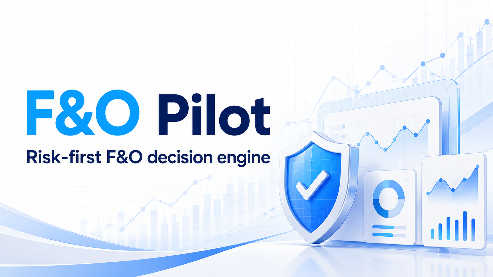
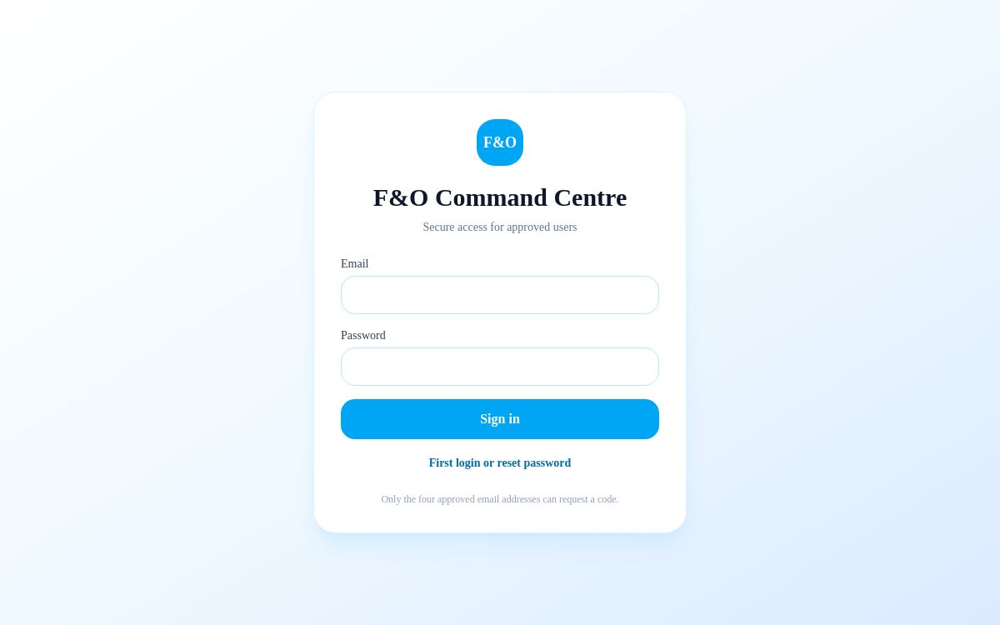
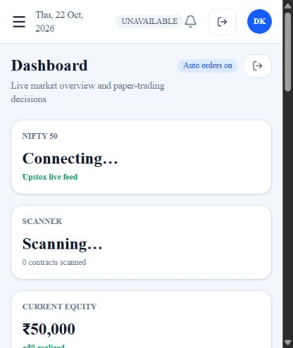
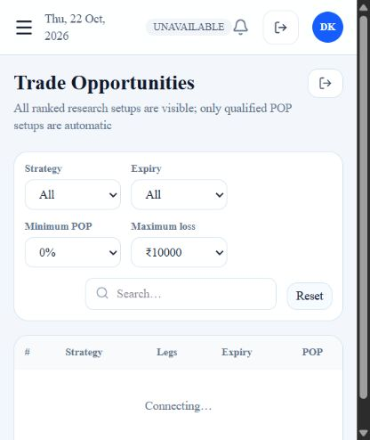
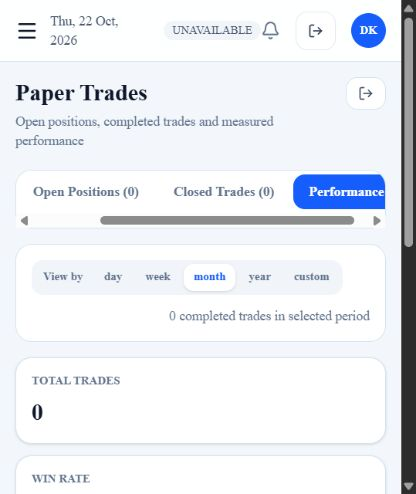
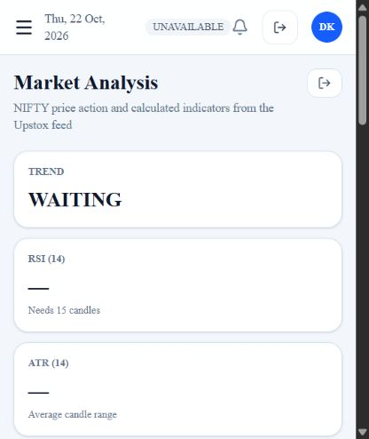
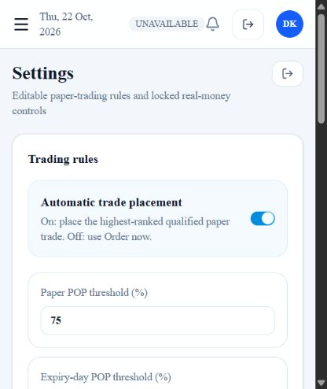
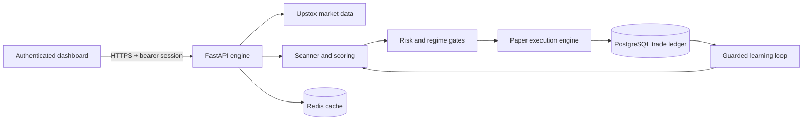

<div align="center">



# F&O Pilot

### Risk-first NIFTY F&O research and autonomous paper-trading command centre

[](#safety-first)
[](#technology)
[](#technology)
[](https://github.com/djha11/fo-pilot)

[Live application](https://fo-pilot-risk-engine.siajha18.chatgpt.site/) · [Features](#features) · [Local setup](#local-setup) · [Architecture](#architecture)

</div>

F&O Pilot is a full-stack decision dashboard for researching NIFTY options spreads, ranking paper-trade opportunities, monitoring positions, enforcing risk limits, and learning from completed trades. It combines live Upstox market data, a conservative scanning engine, automated paper execution, historical regime filtering, and an authenticated white-and-sky-blue web interface.

> [!IMPORTANT]
> This project is an experimental research and paper-trading system. Probability of profit is an estimate—not a guarantee. Nothing in this repository is financial advice, and real-money trading must remain disabled until the complete system has been independently reviewed, backtested, monitored, and approved for production use.

## Product tour

The interface is responsive across desktop and mobile. The live deployment uses email verification, password-based sign-in, expiring backend sessions, and an explicit logout flow. Approved users share the same trading workspace and paper portfolio.

| Secure access | Command dashboard |
|---|---|
|  |  |

| Ranked opportunities | Paper-trade performance |
|---|---|
|  |  |

| Market analysis | Editable risk settings |
|---|---|
|  |  |

> Live values depend on the market-data and backend services being connected. Screenshots taken outside market hours may show the dashboard's safe waiting or unavailable state.

## Features

- **Continuous market research** — scans NIFTY option chains throughout market hours and ranks vertical-spread candidates.
- **Autonomous paper trading** — can enter qualified paper trades, monitor them continuously, and exit at target, stop, timed exit, or explicit user request.
- **Risk-first qualification** — applies configurable probability-of-profit, expected-value, reward/risk, loss-budget, position-count, and liquidity gates.
- **Live market dashboard** — shows market state, NIFTY price and charts, scanner decisions, opportunities, capital usage, open risk, and live paper P&L.
- **Trade transparency** — every opportunity includes strategy legs, expiry, estimated POP, profit/loss bounds, score, and rationale.
- **Historical regime filter** — validates conservative volatility, range, and gap thresholds on held-out NIFTY history before activation.
- **Measured learning loop** — records completed trades and uses guarded, sample-size-aware adjustments without weakening hard risk limits.
- **Performance analytics** — separates open and closed positions and supports daily, weekly, monthly, yearly, and custom-range review.
- **Editable strategy settings** — paper-trading thresholds and limits are controlled from the dashboard rather than hard-coded in the interface.
- **Secure restricted access** — six-digit email verification, PBKDF2 password hashing, expiring sessions, allowlisted users, and logout/session invalidation.

## Architecture



The frontend is deployed as a responsive React application. The backend runs independently as a containerized FastAPI service with PostgreSQL and Redis. Broker access, SMTP credentials, authentication secrets, and database credentials are supplied only at runtime and are never stored in the repository.

## Technology

| Layer | Stack |
|---|---|
| Web application | React 19, TypeScript, Vinext/Vite, Tailwind CSS, shadcn primitives |
| Charts | Lightweight Charts and Recharts |
| API | Python 3.11+, FastAPI, Uvicorn |
| Market data | Upstox APIs |
| Persistence | PostgreSQL, Redis |
| Authentication | Email OTP, PBKDF2-SHA256 passwords, expiring bearer sessions |
| Deployment | Cloudflare-hosted frontend, Dockerized AWS backend |

## Local setup

### Prerequisites

- Node.js 22.13 or newer
- pnpm
- Python 3.11 or newer
- PostgreSQL and Redis
- An Upstox developer application for market-data access
- SMTP credentials for email verification

### Frontend

```bash
pnpm install
pnpm dev
```

Create a production bundle with:

```bash
pnpm build
```

### Backend

```bash
python -m venv .venv
source .venv/bin/activate
pip install -r backend/requirements.txt
uvicorn backend.main:app --reload --port 8000
```

On Windows PowerShell, activate the environment with `.venv\\Scripts\\Activate.ps1`.

Configure runtime secrets outside Git using environment variables or a mounted secret file. The backend expects values such as database and Redis URLs, Upstox credentials, `DASHBOARD_AUTH_SECRET`, and SMTP connection settings. Never commit actual tokens, passwords, OTPs, or API keys.

## Testing

Run the backend safety and data-handling tests:

```bash
pytest backend
```

Validate the frontend production build:

```bash
pnpm build
```

## Safety first

F&O Pilot intentionally supports a `NO_TRADE` decision. A quiet day is a valid result when no candidate satisfies the configured controls. The learning system may refine ranking only after sufficient evidence and must never relax hard loss, POP, liquidity, or exposure limits automatically.

Before any real-money use, add independent model validation, broker-side order reconciliation, kill switches, alerting, audit logs, disaster recovery, regulatory review, and sustained forward paper-trading evidence.

## Repository layout

```text
app/                 Dashboard routes, authentication, and UI
backend/             FastAPI engine, scanner, paper execution, learning
components/ui/       Reusable interface primitives
docs/                Project screenshots
hooks/ and lib/      Shared frontend utilities
public/              Brand and public assets
```

## License

This repository is publicly visible, but no open-source license has been granted. All rights are reserved. Add an explicit license before accepting redistribution or external contributions.

---

<div align="center">
Built for disciplined experimentation: protect capital, measure outcomes, and prefer no trade over a weak trade.
</div>
